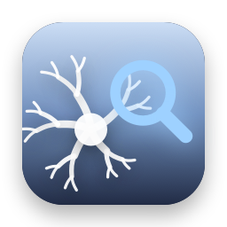

.. _analysistools-brainhound:

brainhound
----------

.. short_description_start

:ref:`analysistools-brainhound` is a command line tool and MCP server for finding and reading public neuroscience data. It searches DANDI, OpenNeuro and NeuroMorpho, and summarizes, browses and reads slices of NWB files on DANDI remotely with HTTP range requests, without downloading the whole file. Every result includes the dataset's license and citation.
:bdg-link-primary:`brainhound <https://stanczykwyatt.github.io/brainhound/>`
:bdg-link-primary:`Source <https://github.com/stanczykwyatt/brainhound>`

.. short_description_end

Compatibility with NWB
^^^^^^^^^^^^^^^^^^^^^^

brainhound reads NWB files stored as HDF5 with its own read-only HDF5 reader (Node.js, no dependencies). It summarizes a file's session, subject, acquisition and processing contents, lists units and electrodes tables, and reads slices of time series and table columns. Datasets compressed with Blosc, Zstandard or LZF, and NWB stored as Zarr, are not supported yet. It never writes files.
