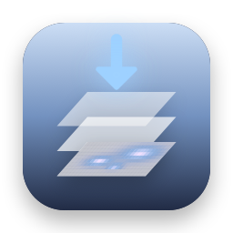

.. _analysistools-dropslice:

dropslice
---------

.. short_description_start

:ref:`analysistools-dropslice` is a static web page, built on h5web, that opens NWB and other HDF5 files in the browser, along with MATLAB, NumPy and Zarr files, and shows their groups, datasets and attributes with line plots, heatmaps, images and tables. Files are read locally and never uploaded.
:bdg-link-primary:`Docs <https://stanczykwyatt.github.io/dropslice/>`
:bdg-link-primary:`Source <https://github.com/stanczykwyatt/dropslice>`

.. short_description_end

Compatibility with NWB
^^^^^^^^^^^^^^^^^^^^^^

dropslice reads NWB files stored as HDF5 through h5wasm, including datasets compressed with Blosc, Zstandard, LZ4 or LZF. It browses any NWB file generically (groups, datasets, attributes and links); it does not interpret specific neurodata_types or need extensions. It is read-only. NWB files stored as Zarr can be opened as Zarr folders.
